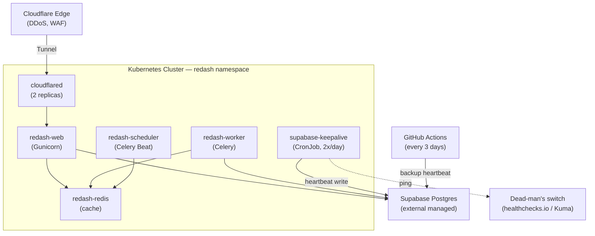

# Redash on Kubernetes (Rackspace Spot)

Deploy [Redash](https://redash.io/) on a cost-effective Kubernetes cluster using Rackspace Spot instances, with Cloudflare Tunnel for secure external access.

## Architecture



## Components

| Component | Purpose | Replicas | Resources |
|-----------|---------|----------|-----------|
| **redash-web** | HTTP server (UI + API) | 1 | 500m-1500m CPU, 896Mi-1536Mi RAM |
| **redash-worker** | Async query execution | 1 | 250m-900m CPU, 448Mi-896Mi RAM |
| **redash-scheduler** | Scheduled queries | 1 | 80m-300m CPU, 192Mi-384Mi RAM |
| **redash-redis** | Cache + job queue | 1 | 120m-500m CPU, 384Mi-768Mi RAM |
| **cloudflared** | Secure tunnel | 2 | 50m-200m CPU, 128Mi-256Mi RAM |
| **supabase-keepalive** | Heartbeat write to Supabase (CronJob, 2x/day) | — | 25m-100m CPU, 32Mi-64Mi RAM |

**Total**: ~1.1 CPU requests, ~2.2Gi RAM requests

## Prerequisites

- Kubernetes cluster (4 vCPU, 7.5GB RAM recommended)
- `kubectl` configured
- Cloudflare account with tunnel configured
- Supabase project (or any PostgreSQL)

## Quick Start

### 1. Configure Environment

```bash
# Copy template and edit with your values
cp .env.example .env
```

Required variables in `.env`:

```bash
# Redash security keys (generate random strings)
REDASH_COOKIE_SECRET=<random-32-char-string>
REDASH_SECRET_KEY=<random-32-char-string>

# Supabase PostgreSQL connection
REDASH_DATABASE_URL=postgresql://postgres:<password>@<host>:5432/postgres

# SMTP for email notifications (optional but recommended)
REDASH_MAIL_SERVER=smtp.gmail.com
REDASH_MAIL_PORT=587
REDASH_MAIL_USE_SSL=false
REDASH_MAIL_USE_TLS=true
REDASH_MAIL_USERNAME=your-email@gmail.com
REDASH_MAIL_PASSWORD=your-app-password
REDASH_MAIL_DEFAULT_SENDER=your-email@gmail.com

# Cloudflare Tunnel token
TUNNEL_TOKEN=eyJhIjoiNj...
```

### 2. Deploy

```bash
./deploy.sh deploy
```

### 3. Access

- **Redash**: https://redash.example.com

## CD - GitHub Actions

The project includes a CD workflow (`.github/workflows/cd.yaml`) that deploys to Kubernetes via `workflow_dispatch` (manual trigger).

### Setup

Configure the following in **Settings > Secrets and variables > Actions**:

#### Secrets (sensitive values, masked in logs)

| Secret | Description |
|--------|-------------|
| `RACKSPACE_REFRESH_TOKEN` | Rackspace Spot API refresh token |
| `REDASH_COOKIE_SECRET` | Session cookie encryption key (`openssl rand -base64 32`) |
| `REDASH_SECRET_KEY` | Application secret key (`openssl rand -base64 32`) |
| `REDASH_DATABASE_URL` | PostgreSQL connection string (Supabase) |
| `REDASH_MAIL_PASSWORD` | SMTP password (Resend API key) |
| `TUNNEL_TOKEN` | Cloudflare Tunnel authentication token |
| `KEEPALIVE_DATABASE_URL` | Supabase connection string for the `keepalive_bot` role (see [Supabase keep-alive](#supabase-keep-alive)) |
| `HC_PING_URL` | *Optional.* Dead-man's switch ping URL for the keep-alive heartbeat |

#### Variables (non-sensitive, visible in logs)

| Variable | Required | Default |
|----------|----------|---------|
| `RACKSPACE_ORG_NAME` | Yes | — |
| `RACKSPACE_CLUSTER_ID` | Yes | — |
| `REDASH_MAIL_DEFAULT_SENDER` | Yes | — |
| `REDASH_MAIL_SERVER` | No | `smtp.resend.com` |
| `REDASH_MAIL_PORT` | No | `587` |
| `REDASH_MAIL_USE_SSL` | No | `false` |
| `REDASH_MAIL_USE_TLS` | No | `true` |
| `REDASH_MAIL_USERNAME` | No | `resend` |

### Usage

1. Go to **Actions** tab in GitHub
2. Select **CD - Deploy to Kubernetes**
3. Click **Run workflow**
4. Optionally enable **Run database migration** (for first deploy or Redash upgrades)

The workflow generates a kubeconfig dynamically via the Rackspace Spot API, processes the secrets template with `envsubst`, and applies all manifests in order.

## Supabase keep-alive

### Why this exists

Supabase pauses free-tier projects after **7 days without user database
activity**, and a project left paused for **90 days can no longer be restored**.
This project has already been paused once and un-paused by hand.

A running Redash does **not** count as activity when nobody opens the UI:

- `redash-web` only answers the Kubernetes probes on `GET /ping`. That endpoint
  logs `query_count=0` and never opens a transaction against Postgres.
- `redash-worker` and `redash-scheduler` poll **Redis**, not Postgres.
- An idle-but-open pooler connection does not count either — the pods had been
  up for 75 days when the project was paused.

So 7 days without opening the UI = zero queries to Supabase = paused project.
Something outside Redash has to write to the database on a schedule.

### Three layers

| Layer | Where | Schedule | Purpose |
|-------|-------|----------|---------|
| 1 | `60-keepalive.yaml` — in-cluster CronJob | 00:23 and 12:23 `America/Bogota` | Primary heartbeat |
| 2 | `.github/workflows/keepalive.yml` — GitHub Actions | Every 3 days, UTC | Survives losing the cluster |
| 3 | `HC_PING_URL` — dead-man's switch | Pinged on every layer-1 success | Alerts when layers 1 and 2 both go silent |

Layer 2 exists because the cluster is a **single preemptible Rackspace Spot
node**. If it gets reclaimed and nobody notices for a week, layer 1 stops
running and the 90-day clock towards data loss starts. Layer 2 is completely
independent of the cluster.

Layer 3 exists because layers 1 and 2 can fail silently — without it the first
sign of trouble is the next Supabase pause email.

Both write layers `UPDATE` the same single row, so `ping_count` increments no
matter which one ran.

> Design notes: `pg_cron` is deliberately **not** used — if the database is
> paused its internal jobs do not run, so it could never resurrect itself, and
> internal activity is not user activity. `SELECT 1` is deliberately not used
> either: Supabase does not document the exact threshold for "sufficient user
> database activity", so the heartbeat performs a real write and read against a
> real table. The table lives in a dedicated `keepalive` schema, never `public`,
> which belongs to Redash's Alembic migrations.

### Setup

**1. Run the bootstrap SQL once.** Open the Supabase SQL Editor as a superuser
and run [`docs/keepalive-bootstrap.sql`](docs/keepalive-bootstrap.sql). It
creates the `keepalive` schema, the `keepalive.heartbeat` table, and a
least-privilege `keepalive_bot` role. Generate a strong password first:

```bash
openssl rand -base64 32 | tr -d '/+=' | head -c 40
```

The dedicated role matters: the same credential is also stored as a GitHub
Actions secret, and reusing the Redash `postgres` superuser there would make a
leaked secret catastrophic. `keepalive_bot` can only read and write one table.

**2. Build the connection string.** The Supabase session pooler (Supavisor)
requires the role name to carry the project-ref suffix:

```
postgresql://keepalive_bot.<project-ref>:<password>@<region>.pooler.supabase.com:5432/postgres
```

Do **not** fall back to the direct `db.<project-ref>.supabase.co` endpoint — on
the free tier it is IPv6-only and GitHub-hosted runners cannot reach it.

Verify the role authenticates through the pooler before wiring anything up:

```bash
psql "postgresql://keepalive_bot.<project-ref>:<password>@<region>.pooler.supabase.com:5432/postgres" \
  -v ON_ERROR_STOP=1 -Atc "select last_ping, ping_count from keepalive.heartbeat"
```

**3. Store the secrets.**

| Where | Name | Notes |
|-------|------|-------|
| `.env` (local `./deploy.sh`) | `KEEPALIVE_DATABASE_URL` | Required |
| `.env` | `HC_PING_URL` | Optional, may be empty |
| GitHub repo secret | `KEEPALIVE_DATABASE_URL` | Used by **both** workflows |
| GitHub repo secret | `HC_PING_URL` | Optional, used by CD only |

**4. Set up the dead-man's switch (optional but recommended).** Create a check
on [healthchecks.io](https://healthchecks.io) with **period 12h, grace 6h**, and
put its ping URL in `HC_PING_URL`. Any URL that accepts a plain `GET` works —
an Uptime Kuma push URL (`https://<kuma-host>/api/push/<token>`) is equally
valid and avoids a new account. Leave the value empty to disable the ping; the
CronJob treats it as optional and skips it when blank.

**5. Deploy** via `./deploy.sh deploy` or the CD workflow. Both apply
`60-keepalive.yaml`.

### Verify it is alive

```sql
select last_ping, ping_count from keepalive.heartbeat;
```

`last_ping` should never be more than ~12 hours old while the cluster is up, and
never more than ~3 days old even if the cluster is gone.

From the cluster:

```bash
# History of recent runs
kubectl get cronjob supabase-keepalive -n redash
kubectl get jobs -n redash -l comp=keepalive

# Force a run right now
kubectl create job --from=cronjob/supabase-keepalive keepalive-manual -n redash
kubectl logs job/keepalive-manual -n redash      # expect: ok last_ping=... count=N
kubectl delete job keepalive-manual -n redash
```

Trigger layer 2 manually from the **Actions** tab → **supabase-keepalive** →
**Run workflow**.

### Troubleshooting

| Symptom | Cause |
|---------|-------|
| Job pod stuck `Pending` | `redash-quota` is nearly full (only ~400m `limits.cpu` of headroom). Do not raise the CronJob's limits; free quota elsewhere. |
| `password authentication failed` | Missing `.<project-ref>` suffix on the username, or the wrong pooler host/region. |
| `permission denied for schema keepalive` | The bootstrap `grant` statements did not run. |
| Job never scheduled after node preemption | `startingDeadlineSeconds: 3600` covers a one-hour gap; longer outages simply wait for the next slot — layer 2 covers that window. |

## File Structure

```
.
├── .github/workflows/
│   ├── cd.yaml            # CD workflow (GitHub Actions)
│   ├── ci.yml             # Manifest lint / validation
│   └── keepalive.yml      # Supabase keep-alive, backup layer
├── 00-namespace.yaml      # Creates 'redash' namespace
├── 02-secrets.yaml        # Secrets template (populated from .env or GitHub Secrets)
├── 05-config.yaml         # Redash configuration
├── 10-redis.yaml          # Redis cache/broker
├── 20-job-migrate.yaml    # Database migration job
├── 30-redash-core.yaml    # Web, Worker, Scheduler deployments
├── 40-cloudflared.yaml    # Cloudflare Tunnel
├── 50-guardrails.yaml     # PDBs, ResourceQuota, NetworkPolicy
├── 60-keepalive.yaml      # Supabase keep-alive CronJob
├── docs/
│   └── keepalive-bootstrap.sql  # One-time SQL: schema, table, keepalive_bot role
├── deploy.sh              # Local deployment automation
└── README.md
```

## Configuration Details

### Concurrency Settings (05-config.yaml)

Tuned for single-user with multiple browser tabs:

| Setting | Value | Purpose |
|---------|-------|---------|
| `REDASH_WEB_WORKERS` | 2 | Gunicorn workers for parallel requests |
| `REDASH_DATABASE_POOL_SIZE` | 3 | DB connections per worker |
| `REDASH_DATABASE_MAX_OVERFLOW` | 2 | Extra connections for spikes |

This allows ~6 concurrent database connections from web, staying well under Supabase limits.

### Resource Quota (50-guardrails.yaml)

Prevents resource exhaustion (matches cluster capacity):

```yaml
requests.cpu: "2"      # Guaranteed CPU
limits.cpu: "4"        # Max burst (= cluster total)
requests.memory: "4Gi"
limits.memory: "6Gi"
```

> **Note**: During `kubectl rollout restart`, K8s tries to create new pods before killing old ones. This can exceed the quota. Use `kubectl delete pod -l app=redash -n redash` instead to force restart.

## Operations

### Update Configuration

```bash
# Edit config
vim 05-config.yaml

# Apply changes
kubectl apply -f 05-config.yaml

# Restart pods to pick up new config
kubectl delete pod -l app=redash -n redash
```

### View Logs

```bash
./deploy.sh logs web
./deploy.sh logs worker
./deploy.sh logs scheduler

# Or directly
kubectl logs -f deployment/redash-web -n redash
```

### Check Status

```bash
./deploy.sh status

# Or
kubectl get pods -n redash
kubectl get events -n redash --sort-by='.lastTimestamp'
```

### Database Migration

Migration runs automatically on first deploy. For version upgrades:

```bash
# Delete old migration job
kubectl delete job redash-migrate -n redash

# Re-apply to run new migrations
kubectl apply -f 20-job-migrate.yaml

# Check status
kubectl logs job/redash-migrate -n redash
```

### Cleanup

```bash
./deploy.sh cleanup
```

## Troubleshooting

### Pods stuck in Pending

Check ResourceQuota:
```bash
kubectl describe resourcequota redash-quota -n redash
```

If quota exceeded, delete old pods or increase quota in `50-guardrails.yaml`.

### 500 Errors / Server Unavailable

1. Check pod health:
   ```bash
   kubectl get pods -n redash
   kubectl describe pod <pod-name> -n redash
   ```

2. Check logs:
   ```bash
   kubectl logs deployment/redash-web -n redash --tail=100
   ```

3. Verify database connectivity:
   ```bash
   kubectl exec -it deployment/redash-web -n redash -- /app/manage.py status
   ```

### Rollout Stuck

ResourceQuota may block new pod creation during rollouts:
```bash
# Force restart by deleting pods
kubectl delete pod -l app=redash,comp=web -n redash
kubectl delete pod -l app=redash,comp=worker -n redash
```

## Security

- **No exposed ports**: All traffic via Cloudflare Tunnel
- **Non-root containers**: All pods run as non-root users
- **Read-only filesystems**: Containers use read-only root FS
- **Dropped capabilities**: All Linux capabilities dropped
- **NetworkPolicy**: Traffic control (currently permissive)
- **ResourceQuota**: Prevents resource exhaustion

## Cost Optimization

This setup is optimized for Rackspace Spot instances:

- **Single replicas**: Minimizes resource usage
- **No LoadBalancer**: Cloudflare Tunnel eliminates LB costs
- **Ephemeral Redis**: No persistent storage costs
- **External DB**: Uses Supabase free/cheap tier

Trade-off: Brief downtime during node preemption (~30-60s).

## License

MIT
