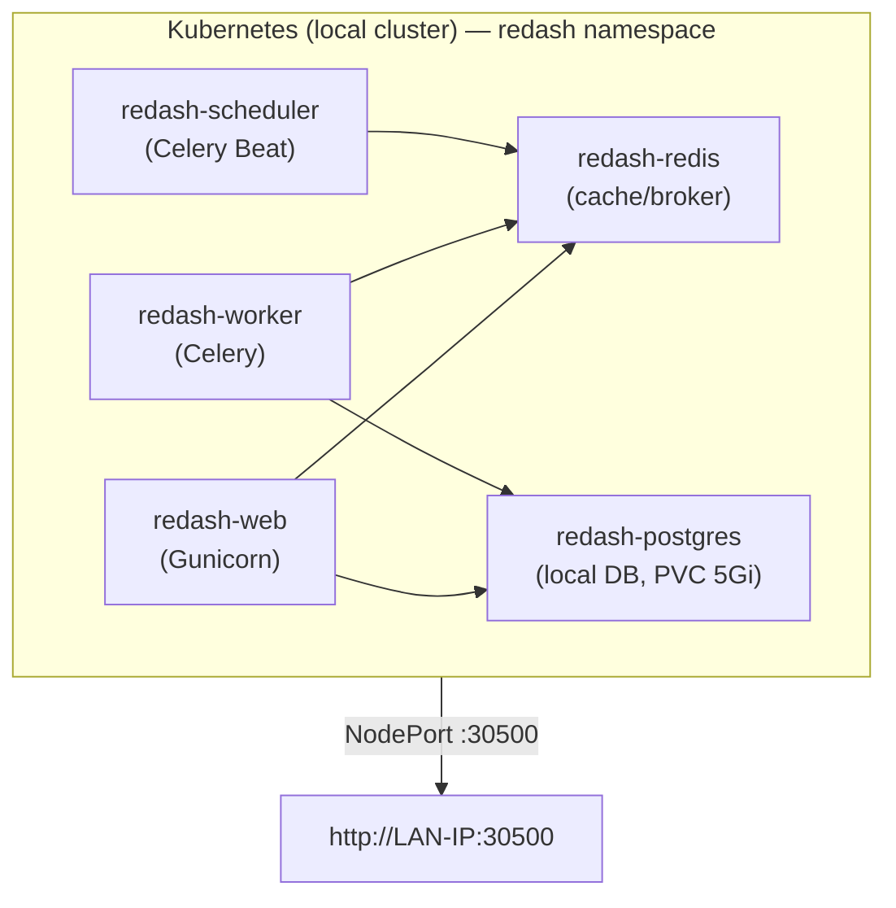

# Redash on Local Kubernetes

Deploy [Redash](https://redash.io/) on a local Kubernetes cluster.
Accessible from your LAN via NodePort — no cloud dependencies.
Works on **macOS**, **Linux**, and **Windows (WSL2)**.

## Architecture



## Components

| Component | Purpose | Resources (req/lim) |
|---|---|---|
| **redash-web** | HTTP server (UI + API) | 500m–1500m CPU, 896Mi–1536Mi RAM |
| **redash-worker** | Async query execution | 250m–900m CPU, 448Mi–896Mi RAM |
| **redash-scheduler** | Scheduled queries | 80m–300m CPU, 192Mi–384Mi RAM |
| **redash-redis** | Cache + job queue | 120m–500m CPU, 384Mi–768Mi RAM |
| **redash-postgres** | PostgreSQL database | 100m–500m CPU, 256Mi–512Mi RAM |

## Prerequisites

- A local Kubernetes cluster (any of the following):

  | Platform | Recommended Options |
  |---|---|
  | **macOS** | [OrbStack](https://orbstack.dev/), [Docker Desktop](https://www.docker.com/products/docker-desktop/), [minikube](https://minikube.sigs.k8s.io/) |
  | **Linux** | [minikube](https://minikube.sigs.k8s.io/), [k3s](https://k3s.io/), [kind](https://kind.sigs.k8s.io/), [microk8s](https://microk8s.io/) |
  | **Windows** | [Docker Desktop](https://www.docker.com/products/docker-desktop/) with WSL2, [minikube](https://minikube.sigs.k8s.io/) in WSL2 |

- `kubectl` configured and connected to your cluster
- `envsubst` (included in most systems; on macOS install via `brew install gettext`)

## Quick Start

```bash
# 1. Create your .env file
cp .env.example .env

# 2. (Optional) Generate secure keys
sed -i '' "s/CHANGE_ME_cookie_secret/$(openssl rand -base64 32)/" .env
sed -i '' "s/CHANGE_ME_secret_key/$(openssl rand -base64 32)/" .env

# 3. Deploy
./deploy.sh deploy
```

The script will:
1. Create the `redash` namespace and all resources
2. Start PostgreSQL and run database migrations
3. Detect your LAN IP and configure `REDASH_HOST`
4. Print the access URLs when ready

## Access

| From | URL |
|---|---|
| This machine | http://localhost:30500 |
| Other PCs on LAN | http://\<your-ip\>:30500 |

## Operations

```bash
./deploy.sh status          # Pod and service status
./deploy.sh logs web        # Tail web server logs
./deploy.sh logs worker     # Tail worker logs
./deploy.sh logs scheduler  # Tail scheduler logs
./deploy.sh cleanup         # Delete everything (including data)
```

### Database Migration (after Redash upgrade)

```bash
kubectl delete job redash-create-db -n redash
kubectl apply -f 20-job-migrate.yaml
kubectl logs job/redash-create-db -n redash -f
```

### Update Configuration

```bash
vim 05-config.yaml
kubectl apply -f 05-config.yaml
kubectl delete pod -l app=redash -n redash   # restart to pick up changes
```

## File Structure

```
├── 00-namespace.yaml      # Creates 'redash' namespace
├── 02-secrets.yaml        # Secrets template (envsubst from .env)
├── 05-config.yaml         # Redash configuration (non-sensitive)
├── 10-redis.yaml          # Redis cache/broker
├── 15-postgres.yaml       # PostgreSQL with PVC
├── 20-job-migrate.yaml    # Database initialization job (create_tables)
├── 30-redash-core.yaml    # Web, Worker, Scheduler + NodePort service
├── 50-guardrails.yaml     # ResourceQuota, NetworkPolicy
├── deploy.sh              # Deployment automation
└── .env.example           # Environment variable template
```

## Environment Variables

| Variable | Required | Description |
|---|---|---|
| `REDASH_COOKIE_SECRET` | Yes | Session cookie encryption key |
| `REDASH_SECRET_KEY` | Yes | Application secret for tokens |
| `POSTGRES_PASSWORD` | Yes | Password for local PostgreSQL |

## Troubleshooting

### Pods stuck in Pending

```bash
kubectl describe resourcequota redash-quota -n redash
```

### Web server not responding

```bash
kubectl get pods -n redash
kubectl logs deployment/redash-web -n redash --tail=50
```

### Reset everything

```bash
./deploy.sh cleanup
./deploy.sh deploy
```

> **Note**: `cleanup` deletes the namespace including the PostgreSQL PVC. All data will be lost.

## License

MIT
